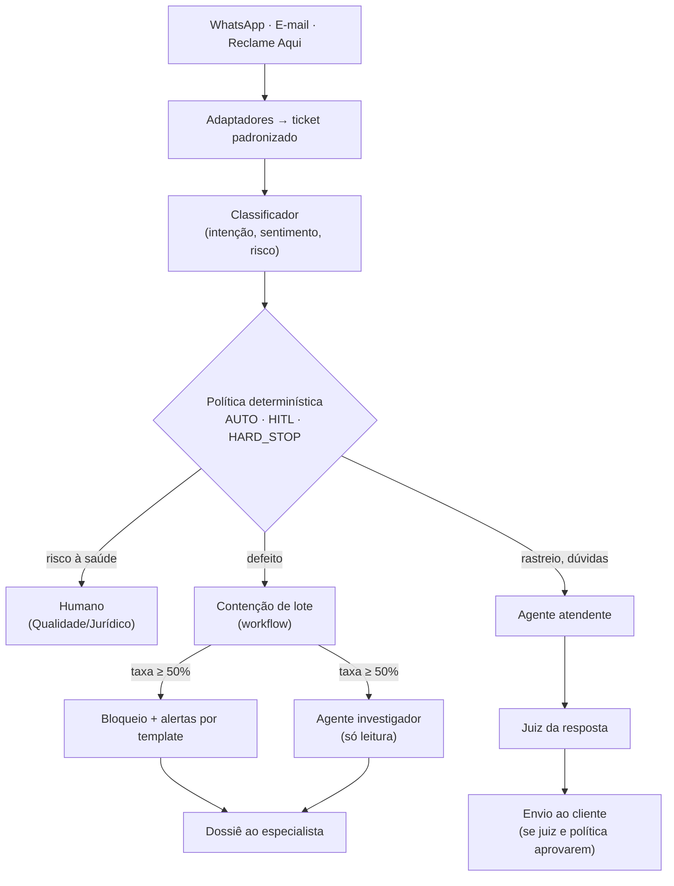

# OmniOps AI

Sistema de **atendimento ao cliente e inteligência de operações** para e-commerce, construído com LLM local, agentes e regras determinísticas.

Ele recebe reclamações de **WhatsApp, e-mail e Reclame Aqui**, faz a triagem e a análise de risco e **detecta defeitos de fabricação por lote**. Quando um lote passa do limite de falhas, o sistema bloqueia as vendas, avisa os compradores que ainda não reclamaram e aciona um agente que **investiga a causa provável** para o especialista humano validar.

> 🚧 **Projeto em desenvolvimento**, didático e de portfólio. **Etapa 4 de 12 concluída.** A tabela abaixo mostra o que já funciona e o que ainda não existe. A especificação completa, com todas as decisões de engenharia, está em [CLAUDE.md](CLAUDE.md).

---

## Status

| Capacidade | Estado |
|---|---|
| Modelo de dados (clientes, pedidos, lotes, unidades com número de série, alertas, auditoria) | ✅ pronto |
| Dados sintéticos reprodutíveis, com uma causa de defeito plantada para avaliar o agente | ✅ pronto |
| Taxa de falha do lote por **unidades distintas** e compradores silenciosos **por pedido** | ✅ pronto |
| Servidor MCP (HTTP) com ferramentas de consulta e de investigação, só leitura | ✅ pronto |
| Camada de LLM trocável por configuração (Ollama local ou API compatível com OpenAI) | ✅ pronto |
| **Agente investigador** de causa raiz | 🚧 próxima etapa |
| Avaliação do investigador e comparação entre modelos | ⏳ planejado |
| Triagem (classificador) e política de decisão com guardrails | ⏳ planejado |
| Orquestrador com pausa para humano (HITL) e notificação ao especialista | ⏳ planejado |
| Agente atendente e juiz da resposta | ⏳ planejado |
| API de webhooks, simulador de tráfego e interface Streamlit | ⏳ planejado |

---

## Como vai funcionar (quando concluído)



### Modelo, workflow ou agente?

Nem tudo que usa IA é um agente. Cada peça é descrita pelo que é:

| Peça | Natureza | Decide o próprio caminho? |
|---|---|---|
| Classificador de triagem | modelo de ML | não |
| Política de decisão | regras determinísticas (Python + SQL) | não |
| Orquestrador e contenção de lote | workflow | não, o caminho é fixo no código |
| Juiz da resposta | passo avaliador com LLM | não |
| **Investigador de causa raiz** | **agente de LLM** | **sim**, escolhe quais análises fazer e quando parar |
| **Atendente** | **agente de LLM** (ReAct) | **sim** |

Os agentes têm **autonomia proporcional à reversibilidade**: podem ler e analisar livremente, mas ações irreversíveis (bloquear lote, alertar clientes, estornar) só acontecem por decisão do código determinístico.

---

## Decisões de engenharia em destaque

- **Probabilístico ≠ determinístico.** O LLM interpreta e investiga; cálculos, regras de negócio e travas de segurança são código testado. O LLM nunca executa SQL.
- **A taxa conta unidades, não reclamações.** Contar tickets fazia um lote parecer crítico (51%) quando só 49 unidades tinham defeito. Os testes cobrem a duplicata, a reclamação sem número de série e o serial de outro lote.
- **Ferramentas desenhadas para um modelo pequeno.** Poucas ferramentas, argumentos enumerados, respostas de até ~400 tokens com taxas já normalizadas, dados pessoais mascarados e garantia testada de que nada é escrito no banco.
- **Agente avaliável por construção.** Os dados sintéticos plantam uma causa conhecida (linha de produção L2) e distratores (transportadora, semana de compra), para medir se o agente acerta em vez de opinar.
- **LLM local, provedor trocável.** Ollama com `qwen3:4b-instruct` numa GPU de 4 GB. A escolha do modelo foi medida: a variante com raciocínio era ~6× mais lenta na mesma tarefa.

Todas as decisões, com o motivo e as alternativas descartadas, estão na seção 5 do [CLAUDE.md](CLAUDE.md).

---

## Stack

Python 3.11+ · FastAPI · Pydantic v2 · SQLAlchemy 2.0 (async) · PostgreSQL 16 · LangGraph · LangChain · MCP Python SDK 2.x · Ollama · Pytest · Docker Compose · Streamlit (planejado) · scikit-learn / sentence-transformers (planejado)

---

## O que dá para rodar hoje

**Pré-requisitos:** Python 3.11+, Docker e, para a parte de LLM, [Ollama](https://ollama.com) com o modelo `qwen3:4b-instruct`.

```bash
# 1. Ambiente
cp .env.example .env
python -m venv .venv
source .venv/bin/activate              # Windows: .venv\Scripts\activate
pip install -e ".[dev]"

# 2. Banco, carga dos dados e servidor MCP
#    (api e ui ainda não existem: suba só estes serviços)
docker compose up -d --build postgres seed_db mcp_server
curl http://localhost:8001/health      # {"status": "ok", ...}

# 3. Testes (os de integração usam um banco de teste separado;
#    sem Postgres, eles são pulados)
pytest

# 4. Opcional: teste contra o Ollama real (texto + chamada de ferramenta)
ollama pull qwen3:4b-instruct
pytest -m ollama -s
```

**Exemplo:** a ferramenta de investigação aponta a causa plantada.

```bash
python -c "import asyncio, json; from mcp_server.investigation_tools import defect_rate_by; print(json.dumps(asyncio.run(defect_rate_by('LOTE-2026-DEF', 'production_line')), ensure_ascii=False, indent=2))"
```

```json
"groups": [
  {"group": "L2", "units": 50, "defective_units": 45, "defect_rate": 0.9},
  {"group": "L1", "units": 50, "defective_units": 4,  "defect_rate": 0.08}
]
```

---

## Estrutura

```text
agents/          ⏳ agentes de LLM: investigador e atendente
workflows/       ⏳ orquestrador LangGraph, contenção de lote, juiz da resposta
integrations/    ⏳ notificação ao especialista (Slack/Teams)
classifiers/     ⏳ classificador de triagem
api/  ui/        ⏳ webhooks e interface
llm/             ✅ fábrica de modelos por papel e dublê para testes
mcp_server/      ✅ servidor MCP e ferramentas (consulta, contenção, investigação)
core/            ✅ configuração, modelo de dados, contratos, política, privacidade
data/            ✅ dados sintéticos reprodutíveis
scripts/         ✅ geração de dados e carga do banco
tests/           ✅ testes unitários, de integração e smoke test do LLM
```

## Roteiro

0 Preparação ✅ · 1 Modelo de dados ✅ · 2 Regras do lote ✅ · 3 Camada de LLM ✅ · 4 Ferramentas de investigação ✅ · **5 Agente investigador** · 6 Avaliação do agente · 7 Triagem e política · 8 Orquestrador e HITL · 9 Agente atendente · 10 Juiz da resposta · 11 API, simulador e interface · 12 Migrações e operação

Detalhes de cada etapa na seção 10 do [CLAUDE.md](CLAUDE.md).
